# Learner Guide — Excel Power Query and Power Pivot

**Course Code:** TGS-2026064177  
**Version:** v5.0 · 12 August 2026  
**Tertiary Infotech Academy Pte Ltd** · UEN: 201200696W

## 1. About This Course

Excel Power Query and Power Pivot (TGS-2026064177) is a 2-day, 16-hour WSQ course that teaches you to turn messy Excel data into clean, refreshable reports using Power Query, and to analyse it with the Power Pivot Data Model and DAX.

**Learning outcomes**

- LO1: Review data sets using Excel Power Query to uncover trends and patterns.
- LO2: Develop methods in Power Pivot to conduct complex analyses tailored to specific datasets.
- LO3: Apply advanced Power Query analytics to examine business issues.

## 2. Before You Start

Microsoft Excel for Windows (Microsoft 365, 2021, 2019 or 2016). Power Query is built in under Data > Get & Transform Data. Power Pivot is enabled from File > Options > Add-ins > COM Add-ins.

**Enabling Power Pivot** (needed from Lab 13): File > Options > Add-ins > set Manage to COM Add-ins > Go > tick *Microsoft Power Pivot for Excel* > OK.

## 3. Key Concepts

### Topic 1 — Review Data with Power Query

- Power Query is Excel's ETL engine: it Extracts data from a source, Transforms it through a recorded list of steps, and Loads the result to a worksheet or the Data Model — repeatably, on every refresh.
- Every transformation is recorded as an Applied Step, so the whole clean-up is auditable and re-runs on new data with one Refresh click.
- Data types are set once in the query, not with worksheet formatting. A wrong type is the single most common cause of a broken refresh.
- Loading as Connection Only keeps a staging query out of the workbook grid, so only the final shaped table consumes rows.
- Column-shaping tools — Fill, Split, Merge, Conditional Column, Custom Column and Column From Examples — replace fragile worksheet formulas.

### Topic 2 — Data Analysis with Power Query and Power Pivot

- Conditional logic in Power Query is built with the Conditional Column dialog, or written directly in M with if / then / else — which is case-sensitive and lowercase, unlike Excel's IF().
- Nesting conditions with and / or lets one column resolve a multi-factor business rule, such as a priority flag driven by both value and status.
- Date.AddDays and the Date functions turn a raw date into a deadline, an age or an ageing bucket that recalculates on every refresh.
- Unpivot turns a wide, human-readable report into the tall, tidy shape that every PivotTable and data model needs. Pivot reverses it.
- Group By aggregates rows to a summary grain — count, sum, average, min, max — without writing a single worksheet formula.
- Append stacks tables with the same shape; the Data Model then relates the stacked facts to their lookup tables for analysis with DAX measures.

### Topic 3 — Advanced Data Analysis using Power Query

- Merge joins two queries on one or more matching columns. Power Query offers six join kinds, and choosing the wrong one silently changes the row count.
- Left Outer keeps every row of the first table — the safe default and the direct equivalent of an XLOOKUP that must not lose records.
- Inner keeps only matches; Anti joins keep only non-matches, which makes them the fastest way to find orphaned or unmatched records.
- An approximate match (VLOOKUP's TRUE) is reproduced in Power Query by binning with a conditional column or by a banding table plus a merge.
- Cross Join pairs every row with every row — useful for building a complete calendar or scenario grid, dangerous on large tables.
- Fuzzy matching scores similarity between untidy text values; a transformation table teaches the engine the pairs it cannot guess.

## 4. Topic 1 — Review Data with Power Query

### 4.1 Lab 01: Load Sales Data and Fix Data Types

| | |
|---|---|
| **Maps to** | LO1 · A1 · K1, K4 — Query data from a table or range and set correct data types. |
| **Starter workbook** | [`lab-01-load-and-data-types.xlsx`](labs/lab-01-load-sales-data-and-fix-data-types/lab-01-load-and-data-types.xlsx) |
| **Tools** | Excel, Power Query Editor, Data Profiling |
| **You will produce** | A clean Sales query loaded to a worksheet with every column correctly typed. |

**Scenario**

The Southbridge Trading sales extract arrives with everything stored as text: order dates read as words, amounts carry a stray currency prefix, and quantities will not sum. The learner loads the range into Power Query, inspects each column with the data-profiling tools, and applies the correct data type to every column so the table can be aggregated.

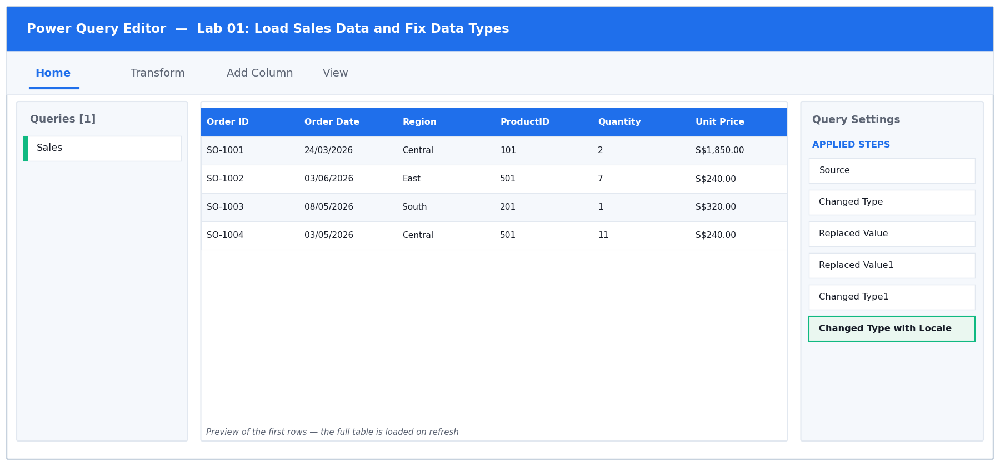

*Figure 1: the Power Query Editor for Lab 01 — queries, data preview and Applied Steps.*

**Step-by-step**

1. Open labs/lab-01-load-sales-data-and-fix-data-types/lab-01-load-and-data-types.xlsx. Look at the Sales sheet: every column is left-aligned, which in Excel means the value is stored as TEXT — including the dates and the amounts.

   > **You should see:** Quantity and Amount are left-aligned, and selecting them shows no Sum in the status bar.

2. Click any single cell inside the data, then choose Data > From Table/Range on the ribbon. In the Create Table dialog, confirm the range is $A$1:$G$61 and that 'My table has headers' is TICKED, then click OK.

   > **You should see:** The Power Query Editor opens in a new window with the Sales data loaded and a query named SalesRaw in the Queries pane on the left.

3. Turn on the data-profiling tools: on the View tab, tick Column quality, Column distribution and Column profile. Then click the Quantity column heading.

   > **You should see:** A profile panel appears under the preview. Column quality reports 100% Valid but the type icon in the header shows ABC (text), not 123.

4. By default the profile is based on the first 1000 rows only. Click the status bar at the bottom-right where it says 'Column profiling based on top 1000 rows' and change it to 'Column profiling based on entire data set' so the quality figures cover every row.

5. Fix Quantity first. Click the ABC icon to the LEFT of the Quantity column name and choose Whole Number from the drop-down. When Power Query asks, choose Replace current transformation.

   > **You should see:** Quantity becomes right-aligned, the header icon changes to 123, and a 'Changed Type' step appears in Applied Steps on the right.

6. Now try the same on Unit Price — click its ABC icon and choose Decimal Number. This FAILS because the values carry an 'S$' prefix and thousands separators.

   > **You should see:** Error cells appear and Column quality reports a percentage of Error for that column.

7. Undo that step by clicking the X next to the failed 'Changed Type' step in Applied Steps. Instead, select BOTH Unit Price and Amount (click Unit Price, then Ctrl-click Amount), then choose Transform > Replace Values. Replace 'S$' with nothing (leave Replace With empty) and click OK. Repeat the Replace Values step to remove the comma thousands separator.

8. With Unit Price and Amount still selected, choose Transform > Data Type > Decimal Number.

   > **You should see:** Both columns right-align and show numeric values such as 1850.00. Selecting them shows a Sum in the status bar.

9. Fix the dates. Right-click the Order Date column header and choose Change Type > Using Locale. Set Data Type to Date and Locale to English (Singapore), then click OK. This is what makes 05/03/2026 read as 5 March, not 3 May.

   > **You should see:** Order Date shows a calendar icon in the header and the values display as dates.

10. Set the remaining columns: Order ID and Region to Text, ProductID to Whole Number. Then rename the query — double-click SalesRaw in the Queries pane and type Sales.

11. Load the result. Choose Home > Close & Load > Close & Load To…, select Table, choose New worksheet, and click OK.

   > **You should see:** A new worksheet appears with the cleaned table, and the Queries & Connections pane on the right reports 'Sales — 60 rows loaded'.

**Test it:** Quantity and Amount sum in the status bar, Order Date filters offer date pickers, and Column quality reports 0% error on every column.

**Troubleshooting**

| Symptom | Fix |
|---|---|
| Dates come out as 3 May instead of 5 March | You used a plain Change Type instead of Change Type > Using Locale. Delete the step and redo it with Locale set to English (Singapore). |
| DataFormat.Error: We couldn't convert to Number | The S$ prefix or the comma separator is still present. Run Replace Values for both BEFORE changing the data type. |
| Quantity still will not sum after loading | The type change was applied to the wrong column, or a later step overwrote it. Click the last Changed Type step and check which columns it lists. |

### 4.2 Lab 02: Combine an External Workbook as a Connection Only

| | |
|---|---|
| **Maps to** | LO1 · A1 · K4 — Query data from another Excel file and load as connection only. |
| **Starter workbook** | [`lab-02-external-connection.xlsx`](labs/lab-02-combine-an-external-workbook-as-a-connection-only/lab-02-external-connection.xlsx) |
| **Tools** | Excel, Power Query Editor, External workbook source |
| **You will produce** | A PriceList staging query held as Connection Only, ready to be merged later. |

**Scenario**

The regional price list lives in a separate workbook that the finance team refreshes monthly. The learner connects to that external file, loads it as Connection Only so it does not clutter the workbook grid, and confirms the connection refreshes independently.

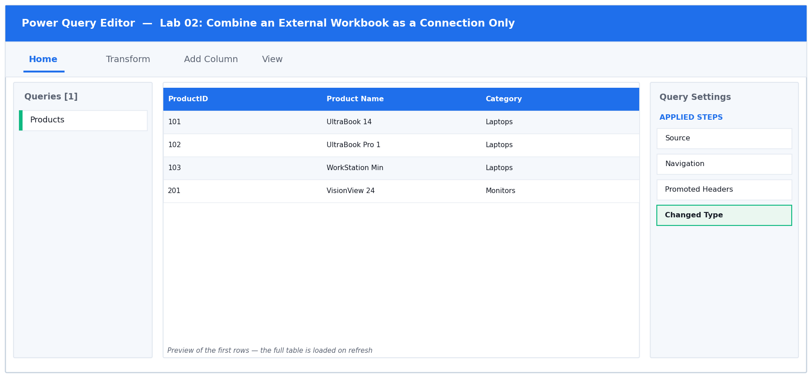

*Figure 2: the Power Query Editor for Lab 02 — queries, data preview and Applied Steps.*

**Step-by-step**

1. Open labs/lab-02-combine-an-external-workbook-as-a-connection-only/lab-02-external-connection.xlsx. Note that this workbook holds only the Products list — the prices live in the separate file price-list-source.xlsx in the SAME folder.

2. Choose Data > Get Data > From File > From Excel Workbook. Browse to the lab folder and select price-list-source.xlsx, then click Import.

3. The Navigator window opens showing the objects inside that workbook. Click the PriceList table (the grid icon, not the sheet icon) to see a preview on the right.

   > **You should see:** A preview showing ProductID, Unit Price and List Price for 13 products.

4. Click Transform Data — NOT Load. This opens the Power Query Editor so you can control the data types and the load destination yourself.

   > **You should see:** The Editor opens with a new query named PriceList.

5. Check the headers. If the first row of data is being used as data rather than as headers, choose Home > Use First Row as Headers.

6. Set the types: ProductID to Whole Number, Unit Price and List Price to Decimal Number.

7. Now load it as a connection only. Choose Home > Close & Load > Close & Load To…. In the Import Data dialog select 'Only Create Connection'. Leave 'Add this data to the Data Model' UNTICKED. Click OK.

   > **You should see:** No new worksheet is created. The Queries & Connections pane lists PriceList with the caption 'Connection only'.

8. Confirm the connection is live rather than a copy. Open Data > Queries & Connections, hover over PriceList, and read the peek window — it shows the source file path.

   > **You should see:** The peek shows the full path to price-list-source.xlsx. Replacing that file with an updated one of the same shape and clicking Refresh All would bring the new prices straight through.

**Test it:** The Queries & Connections pane lists PriceList as 'Connection only', and no new worksheet was created.

**Troubleshooting**

| Symptom | Fix |
|---|---|
| The Navigator shows sheets but no tables | The source workbook has no named table on that sheet. Select the SHEET object instead, then use Use First Row as Headers in the Editor. |
| A worksheet was created anyway | You clicked Load instead of Close & Load To…. Right-click the query in Queries & Connections, choose Load To…, and switch it to Only Create Connection. |
| Refresh fails with 'Could not find file' | The source workbook was moved or renamed. Open Data > Get Data > Data Source Settings, select the source, and click Change Source. |

### 4.3 Lab 03: Fill Down and Fill Up a Ragged Report

| | |
|---|---|
| **Maps to** | LO1 · A1 · K2 — Repair merged-cell style gaps with Fill Down and Fill Up. |
| **Starter workbook** | [`lab-03-fill-down-up.xlsx`](labs/lab-03-fill-down-and-fill-up-a-ragged-report/lab-03-fill-down-up.xlsx) |
| **Tools** | Excel, Power Query Editor, Fill Down / Fill Up |
| **You will produce** | A rectangular headcount table with no blank grouping cells. |

**Scenario**

A departmental headcount report was typed for human eyes: the region name appears only on the first row of each block, and the reporting quarter sits below its group. The learner uses Fill Down and Fill Up to push those values across every row so the table becomes machine-readable.

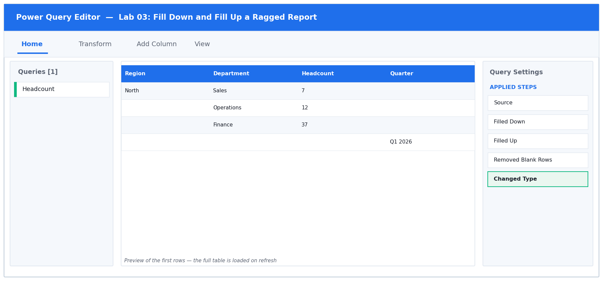

*Figure 3: the Power Query Editor for Lab 03 — queries, data preview and Applied Steps.*

**Step-by-step**

1. Open labs/lab-03-fill-down-and-fill-up-a-ragged-report/lab-03-fill-down-up.xlsx. Study the Headcount sheet: the Region name appears only on the FIRST row of each block, and the Quarter sits on a row BELOW its group. There are also blank spacer rows.

   > **You should see:** Region has values on only 5 of the 24 rows; the rest are blank.

2. Click any cell in the data and choose Data > From Table/Range. Confirm the headers checkbox is ticked and click OK.

3. In the Editor, look at the Region column. The blanks show as 'null' — that is what Fill works on.

   > **You should see:** Blank cells display the word null in grey italics.

4. Click the Region column header to select the whole column, then choose Transform > Fill > Down.

   > **You should see:** Each region name now repeats down through the rows that were null, until the next region begins.

5. Click the Quarter column header, then choose Transform > Fill > Up. This lifts each quarter value into the null rows ABOVE it — which is where its group actually sits.

   > **You should see:** Every row now carries a Quarter value.

6. Remove the leftover spacer rows. Choose Home > Remove Rows > Remove Blank Rows.

   > **You should see:** The row count in the status bar drops to 15 — the real headcount records, three departments for each of the five regions.

7. Set the types: Region, Department and Quarter to Text, Headcount to Whole Number. Rename the query to Headcount and choose Home > Close & Load To… > Table > New worksheet.

   > **You should see:** A rectangular table where every row carries a Region, a Department, a Headcount and a Quarter.

**Test it:** Every row carries a Region and a Quarter value, and the row count matches the number of real headcount records.

**Troubleshooting**

| Symptom | Fix |
|---|---|
| Fill Down does nothing | The blank cells contain an empty string rather than null. Select the column, choose Transform > Replace Values, leave Value To Find empty, and replace with null — or use Transform > Replace Values > Replace empty strings with null. |
| Fill Down carried a value past where it should stop | There was no spacer separating the blocks. Remove Blank Rows AFTER the fills, never before — the blanks are what bound each group. |
| The row count is wrong | Remove Blank Rows was applied before the fills. Reorder the steps by dragging them in Applied Steps. |

### 4.4 Lab 04: Split Columns by Delimiter and into Rows

| | |
|---|---|
| **Maps to** | LO1 · A1 · K2 — Split a column by delimiter, into columns and into rows. |
| **Starter workbook** | [`lab-04-split-columns.xlsx`](labs/lab-04-split-columns-by-delimiter-and-into-rows/lab-04-split-columns.xlsx) |
| **Tools** | Excel, Power Query Editor, Split Column |
| **You will produce** | A normalised customer table with one product per row. |

**Scenario**

The CRM export packs the customer's full name into one field and lists every product a customer bought as a comma-separated string. The learner splits the name into First and Last Name columns, then splits the product list into rows so each purchase becomes its own record.

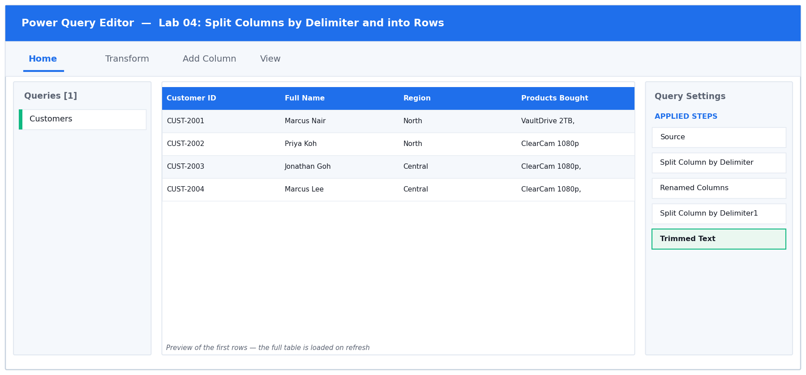

*Figure 4: the Power Query Editor for Lab 04 — queries, data preview and Applied Steps.*

**Step-by-step**

1. Open labs/lab-04-split-columns-by-delimiter-and-into-rows/lab-04-split-columns.xlsx. The Customers sheet packs the customer's whole name into Full Name, and every product a customer bought into one comma-separated Products Bought field.

2. Load it with Data > From Table/Range.

3. Select the Full Name column, then choose Transform > Split Column > By Delimiter.

4. In the dialog set Select or enter delimiter to Space. Under 'Split at', choose 'Left-most delimiter' — this keeps a double-barrelled surname such as 'Wei Ming Tan' intact as far as possible. Click OK.

   > **You should see:** Two new columns appear: Full Name.1 and Full Name.2.

5. Rename them. Double-click the Full Name.1 header and type First Name; double-click Full Name.2 and type Last Name.

6. Now the products. Select the Products Bought column and choose Transform > Split Column > By Delimiter again. Set the delimiter to Comma.

7. Expand 'Advanced options' in the same dialog and change 'Split into' from Columns to ROWS. Click OK. This is the key decision in this lab: rows, not columns, because a customer can buy any number of products.

   > **You should see:** The row count jumps from 40 to roughly 80 — one row per customer per product. A customer who bought three products now occupies three rows.

8. The split leaves a leading space on every value after the first. Select the Products Bought column and choose Transform > Format > Trim.

   > **You should see:** Values line up with no leading space.

9. Set every column to Text, rename the query to Customers, and choose Home > Close & Load To… > Table > New worksheet.

**Test it:** A customer who bought three products now occupies three rows, and no product value has a leading space.

**Troubleshooting**

| Symptom | Fix |
|---|---|
| Splitting the name produced three or four columns | You chose 'Each occurrence of the delimiter' instead of 'Left-most delimiter'. Click the gear icon on the Split step and change it. |
| The products split into columns, not rows | Advanced options > Split into was left on Columns. Delete the step and redo it, expanding Advanced options first. |
| Product names still have a leading space | Trim was applied before the split, or to the wrong column. Apply Transform > Format > Trim to the product column AFTER the split into rows. |

### 4.5 Lab 05: Add Conditional, Custom and Example-Driven Columns

| | |
|---|---|
| **Maps to** | LO1 · A1 · K1, K2 — Add conditional columns, custom columns and Column From Examples. |
| **Starter workbook** | [`lab-05-add-columns.xlsx`](labs/lab-05-add-conditional-custom-and-example-driven-columns/lab-05-add-columns.xlsx) |
| **Tools** | Excel, Power Query Editor, Conditional Column, Custom Column, Column From Examples |
| **You will produce** | A Sales query carrying Value Band, Line Total and Order Ref columns. |

**Scenario**

Management wants each order classified into a value band, a line total calculated, and an order reference built from existing fields. The learner uses the Conditional Column dialog for the band, a Custom Column with an M expression for the total, and Column From Examples to let Power Query infer the reference pattern.

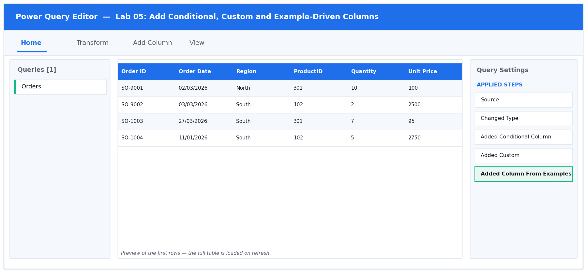

*Figure 5: the Power Query Editor for Lab 05 — queries, data preview and Applied Steps.*

**Step-by-step**

1. Open labs/lab-05-add-conditional-custom-and-example-driven-columns/lab-05-add-columns.xlsx and load the Orders sheet with Data > From Table/Range. Note rows SO-9001 (Amount exactly 1000) and SO-9002 (Amount exactly 5000) — these are the boundary cases you will test.

2. Add the value band. Choose Add Column > Conditional Column. Set the New column name to Value Band.

3. Build the FIRST rule: If Amount is greater than or equal to 5000, Then output High. Click 'Add Clause' and build the second rule: Else If Amount is greater than or equal to 1000, Then Medium. Set the final Else to Low. Click OK.

   > **You should see:** A Value Band column appears. SO-9002 (5000) reads High and SO-9001 (1000) reads Medium — because the tests use >=, not >.

4. The ORDER of those rules matters: the first rule that is true wins. If you had put the 1000 rule first, every high-value order would read Medium. Click the gear icon on the step to reopen the dialog and confirm 5000 sits above 1000.

5. Add the line total. Choose Add Column > Custom Column, set the New column name to Line Total, and enter this formula in the Custom column formula box:

   ```m
   [Quantity] * [Unit Price]
   ```

   > **You should see:** The message 'No syntax errors have been detected' appears at the bottom of the dialog. Double-click a column name in the 'Available columns' list on the right to insert it rather than typing it.

6. Click OK, then set Line Total to Decimal Number.

   > **You should see:** Line Total equals Quantity x Unit Price on every row.

7. Now let Power Query infer a pattern. Choose Add Column > Column From Examples > From All Columns. A new empty column opens on the right with an editable first cell.

8. In the first row of that new column, type SBT-NORTH-1001 and press Enter. Power Query analyses the other columns, guesses the pattern, and fills the rest of the column.

   > **You should see:** The remaining rows populate automatically, and the M it generated is displayed in the bar at the top of the pane. Check two or three rows before accepting.

9. Click OK, rename the column to Order Ref, then choose Home > Close & Load To… > Table > New worksheet.

**Test it:** Value Band shows High/Medium/Low correctly at the 1000 and 5000 boundaries, and Line Total equals Quantity x Unit Price on every row.

**Troubleshooting**

| Symptom | Fix |
|---|---|
| Every order shows Medium | The rules are in the wrong order. The >= 5000 rule must come first — the first matching rule wins. |
| Token Eof expected in the Custom Column dialog | A bracket or operator is missing. Insert column names by double-clicking them in the Available columns list instead of typing them. |
| Column From Examples produced the wrong pattern | One example was not enough. Type a correct value into a second row too, and the guess will refine. |
| Line Total shows as text | The new column arrived as type Any. Set it explicitly to Decimal Number. |

### 4.6 Lab 06: Merge Columns, Sort and Filter

| | |
|---|---|
| **Maps to** | LO1 · A1 · K2, K3 — Merge columns, then sort and filter data in Power Query. |
| **Starter workbook** | [`lab-06-merge-sort-filter.xlsx`](labs/lab-06-merge-columns-sort-and-filter/lab-06-merge-sort-filter.xlsx) |
| **Tools** | Excel, Power Query Editor, Merge Columns, Sort, Filter |
| **You will produce** | A despatch shortlist query, sorted and filtered at source. |

**Scenario**

The despatch team needs a single address label field and a shortlist of the orders that actually need attention. The learner merges the address parts into one column with a chosen separator, then applies sorting and filtering inside the query so the refresh always returns the shortlist.

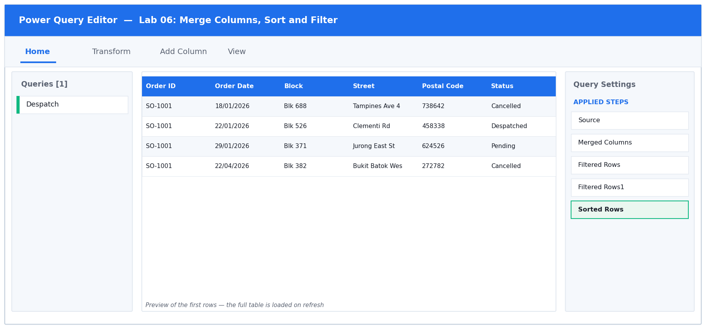

*Figure 6: the Power Query Editor for Lab 06 — queries, data preview and Applied Steps.*

**Step-by-step**

1. Open labs/lab-06-merge-columns-sort-and-filter/lab-06-merge-sort-filter.xlsx and load the Despatch sheet.

2. Build the address label. Click the Block column header, then Ctrl-click Street, then Ctrl-click Postal Code — IN THAT ORDER. The order you click is the order they will be joined.

   > **You should see:** All three columns are highlighted.

3. Choose Transform > Merge Columns. Set Separator to Comma, set the New column name to Address Label, and click OK.

   > **You should see:** The three columns are replaced by a single Address Label column reading like 'Blk 123,Ang Mo Kio Ave 3,560123'.

4. Note that Merge Columns on the TRANSFORM tab REPLACES the source columns. If you want to keep them, use Add Column > Merge Columns instead — the same dialog, but it adds a new column.

5. Filter out the cancelled orders. Click the drop-down arrow on the Status column header, untick Cancelled, and click OK.

   > **You should see:** A filter icon appears on the Status header and a 'Filtered Rows' step is added to Applied Steps.

6. Filter by value. Click the drop-down on the Amount column and choose Number Filters > Greater Than. Enter 1000 and click OK.

7. Sort the result. Click the drop-down on Order Date and choose Sort Descending. Then click the drop-down on Amount and choose Sort Descending as well.

   > **You should see:** Small 1 and 2 badges appear on the two column headers showing the sort priority — Order Date is the primary sort, Amount the secondary.

8. Look at Applied Steps on the right. Every action you took is listed in order. Click each step in turn to watch the table change — this is the audit trail that makes the whole clean-up reproducible.

9. Rename the query to Despatch Shortlist and choose Home > Close & Load To… > Table > New worksheet.

**Test it:** The query returns only non-cancelled orders above 1000, newest first, and Address Label reads as one comma-separated string.

**Troubleshooting**

| Symptom | Fix |
|---|---|
| The source columns disappeared after merging | That is what Transform > Merge Columns does. Use Add Column > Merge Columns if you need to keep them. |
| The address parts are in the wrong order | Merge Columns follows your Ctrl-click order. Delete the step and re-select Block, then Street, then Postal Code. |
| Sorting by the second column undid the first | You sorted them in the wrong sequence. Sort by the PRIMARY column first; the badges on the headers show the resulting priority. |
| The postal code lost its leading zero | It was typed as a number somewhere upstream. Set the column to Text before the merge. |

## 5. Topic 2 — Data Analysis with Power Query and Power Pivot

### 5.7 Lab 07: Conditional Logic with IF in M

| | |
|---|---|
| **Maps to** | LO2 · A2 · K1, K2 — Write IF logic in the Power Query M language. |
| **Starter workbook** | [`lab-07-if-formulas.xlsx`](labs/lab-07-conditional-logic-with-if-in-m/lab-07-if-formulas.xlsx) |
| **Tools** | Excel, Power Query Editor, Custom Column, M language |
| **You will produce** | A Shipping Cost column driven by a hand-written M if expression. |

**Scenario**

The Conditional Column dialog cannot express every rule, so the learner moves to the Custom Column window and writes M directly. The lab contrasts Excel's IF() with M's lowercase, case-sensitive if / then / else and shows why a missing else is an error.

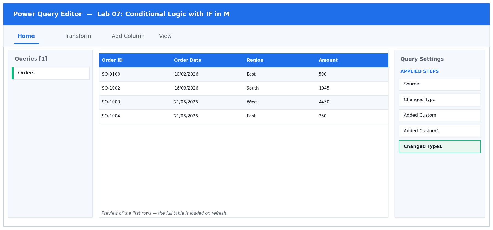

*Figure 7: the Power Query Editor for Lab 07 — queries, data preview and Applied Steps.*

**Step-by-step**

1. Open labs/lab-07-conditional-logic-with-if-in-m/lab-07-if-formulas.xlsx and load the Orders sheet. Row SO-9100 has an Amount of exactly 500 — the boundary case.

2. Choose Add Column > Custom Column. Set the New column name to Shipping Cost and type this into the formula box, exactly as shown — all keywords lowercase:

   ```m
   if [Amount] >= 500 then 0 else 15
   ```

   > **You should see:** 'No syntax errors have been detected' appears at the foot of the dialog. Click OK.

3. Now deliberately break it to learn the error. Click the gear icon on the new step and change 'if' to 'If' with a capital I. Watch the dialog.

   > **You should see:** The message changes to a syntax error — 'Token Eof expected'. M is CASE SENSITIVE; this is the single most common beginner error. Change it back to lowercase.

4. Break it a second way: delete the ' else 15' so the formula reads only 'if [Amount] >= 500 then 0'.

   > **You should see:** Another syntax error. Unlike Excel's IF(), every if in M MUST have an else. Restore the else clause and click OK.

5. Add a second column. Choose Add Column > Custom Column, name it Free Shipping, and enter a bare comparison — no if needed, because a comparison already returns a logical value:

   ```m
   [Amount] >= 500
   ```

   > **You should see:** The column fills with TRUE and FALSE.

6. Set the types: Shipping Cost to Decimal Number and Free Shipping to True/False.

   > **You should see:** Free Shipping shows a TRUE/FALSE icon in its header.

7. Check the boundary. Filter Order ID to SO-9100 and read its two new columns.

   > **You should see:** SO-9100 (Amount exactly 500) shows Shipping Cost 0 and Free Shipping TRUE, because the test is >= and not >.

8. Remove the filter, then choose Home > Close & Load To… > Table > New worksheet.

**Test it:** Orders of 500 or more show Shipping Cost 0 and Free Shipping TRUE; the boundary row at exactly 500 qualifies.

**Troubleshooting**

| Symptom | Fix |
|---|---|
| Token Eof expected | A capitalised If/Then/Else, or a missing else. All M keywords are lowercase and every if needs an else. |
| The name '[Amount]' wasn't recognised | The column name does not match exactly — check spelling, spaces and case. Double-click the name in the Available columns list to insert it. |
| Shipping Cost shows as text | The column arrived as type Any. Set it to Decimal Number explicitly. |

### 5.8 Lab 08: Nest IF with AND for a Priority Flag

| | |
|---|---|
| **Maps to** | LO2 · A2 · K2 — Nest conditions with and / or to resolve a multi-factor rule. |
| **Starter workbook** | [`lab-08-nested-if-and.xlsx`](labs/lab-08-nest-if-with-and-for-a-priority-flag/lab-08-nested-if-and.xlsx) |
| **Tools** | Excel, Power Query Editor, Custom Column, M logical operators |
| **You will produce** | A Priority column classifying every order as Escalate, Watch or Normal. |

**Scenario**

An order is escalated only when it is both high value and already overdue. The learner nests conditions using M's and / or operators to produce a single Priority column, then verifies each branch against a worked truth table.

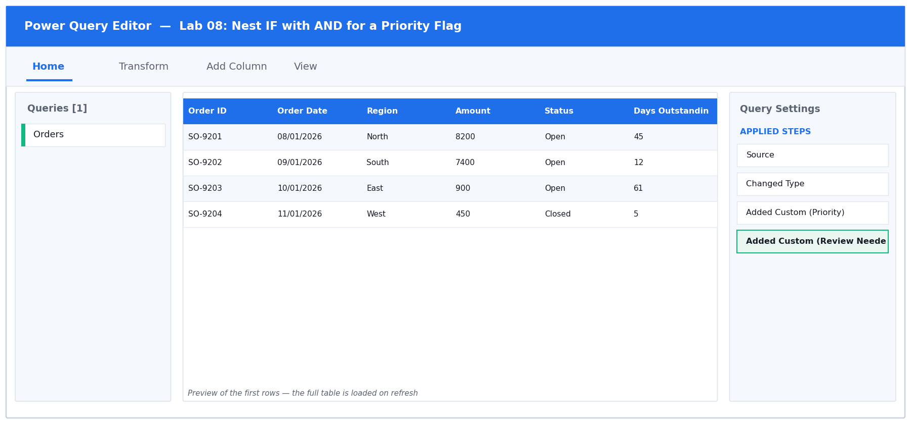

*Figure 8: the Power Query Editor for Lab 08 — queries, data preview and Applied Steps.*

**Step-by-step**

1. Open labs/lab-08-nest-if-with-and-for-a-priority-flag/lab-08-nested-if-and.xlsx and load the Orders sheet. Rows SO-9201 to SO-9204 are built to cover all four branches of the truth table.

2. Choose Add Column > Custom Column and name it Priority. Enter this nested expression. Note that 'and' and 'or' are lowercase operators, not functions with brackets like Excel's AND():

   ```m
   if [Amount] >= 5000 and [Days Outstanding] > 30 then "Escalate"
   else if [Amount] >= 5000 or [Days Outstanding] > 30 then "Watch"
   else "Normal"
   ```

   > **You should see:** No syntax errors. Click OK — a Priority column appears.

3. Verify each branch against the four prepared rows. Filter Order ID to show only SO-9201 to SO-9204 and read the Priority values.

   > **You should see:** SO-9201 (8200 and 45 days) = Escalate — both conditions true. SO-9202 (7400 but only 12 days) = Watch — value only. SO-9203 (900 but 61 days) = Watch — ageing only. SO-9204 (450, 5 days) = Normal — neither.

4. That is the difference between and and or: 'and' requires BOTH sides to be true, 'or' requires EITHER. The first rule catches the rows where both are true; the second catches the rest where at least one is.

5. Add a second rule combining a text test with a numeric test. Choose Add Column > Custom Column, name it Review Needed, and enter:

   ```m
   if [Status] <> "Closed" and [Days Outstanding] > 60 then "Yes"
   else "No"
   ```

   > **You should see:** The <> operator means 'is not equal to'. Text comparisons in M are case sensitive, so "Closed" and "closed" are different values.

6. Remove the filter. Now filter the Priority column to Escalate only and read the row count in the status bar.

   > **You should see:** The status bar reports how many orders qualify for escalation — record this number, you will need it in the assessment.

7. Remove the filter and choose Home > Close & Load To… > Table > New worksheet.

**Test it:** Only orders meeting BOTH the value and ageing tests read Escalate; orders meeting one read Watch.

**Troubleshooting**

| Symptom | Fix |
|---|---|
| Everything reads Escalate | You used 'or' where the first rule needs 'and'. The first rule must require BOTH conditions. |
| Expression.Error on the text comparison | Text values must be in double quotes: "Closed", not Closed. |
| Nothing reads Escalate | The two conditions are contradictory, or the thresholds are wrong. Check the operator direction: >= 5000 for value, > 30 for days. |

### 5.9 Lab 09: Calculate Deadlines with Date.AddDays

| | |
|---|---|
| **Maps to** | LO2 · A2 · K1, K3 — Use Date functions to derive deadlines and ageing buckets. |
| **Starter workbook** | [`lab-09-adddays-deadline.xlsx`](labs/lab-09-calculate-deadlines-with-date-adddays/lab-09-adddays-deadline.xlsx) |
| **Tools** | Excel, Power Query Editor, Date functions, Custom Column |
| **You will produce** | An invoice ageing query with Due Date, Days Overdue and Ageing Bucket. |

**Scenario**

Each invoice carries payment terms in days. The learner derives the due date with Date.AddDays, compares it against a fixed reporting date to produce days overdue, and bins the result into ageing buckets the finance team recognises.

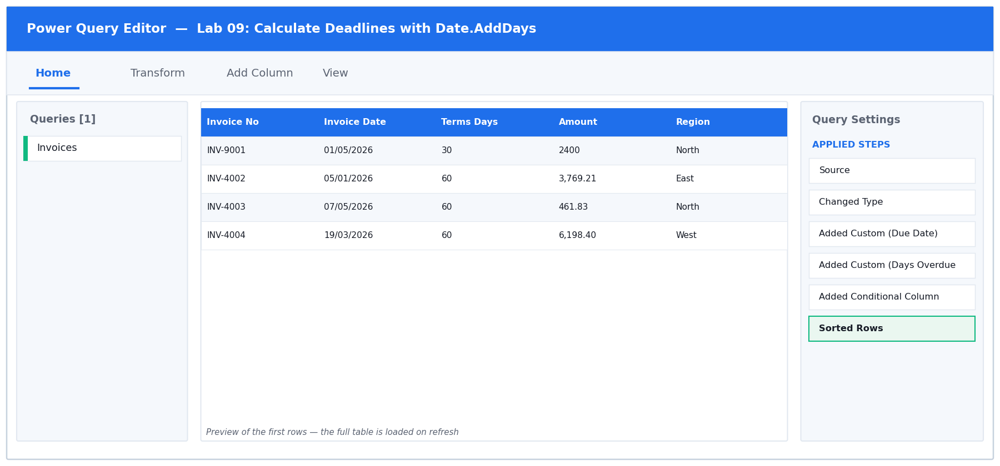

*Figure 9: the Power Query Editor for Lab 09 — queries, data preview and Applied Steps.*

**Step-by-step**

1. Open labs/lab-09-calculate-deadlines-with-date-adddays/lab-09-adddays-deadline.xlsx and load the Invoices sheet. Row INV-9001 is the worked example: dated 1 May 2026 with 30-day terms.

2. Confirm Invoice Date really is a Date. Look at the icon in its header — it must be a calendar, not ABC. If it is text, use Transform > Data Type > Date.

3. Choose Add Column > Custom Column, name it Due Date, and enter:

   ```m
   Date.AddDays([Invoice Date], [Terms Days])
   ```

   > **You should see:** M function names are case sensitive and dot-separated — Date.AddDays, not date.adddays or DateAdd.

4. Click OK and set Due Date to type Date.

   > **You should see:** INV-9001 shows a Due Date of 31/05/2026 — 1 May plus 30 days.

5. Add the ageing. Choose Add Column > Custom Column, name it Days Overdue, and enter this, using a fixed reporting date of 30 June 2026 so everyone's answer matches:

   ```m
   Duration.Days(#date(2026,6,30) - [Due Date])
   ```

   > **You should see:** The #date(yyyy,mm,dd) literal is how you write a fixed date in M. Subtracting two dates gives a duration; Duration.Days converts that to a whole number.

6. Click OK and set Days Overdue to Whole Number.

   > **You should see:** INV-9001 shows exactly 30 days overdue — 30 June minus 31 May.

7. Bucket the ages. Choose Add Column > Conditional Column and name it Ageing Bucket. Build the rules in this order: Days Overdue <= 0 then Current; <= 30 then '1-30 Days'; <= 60 then '31-60 Days'; Else '60+ Days'.

   > **You should see:** Remember the first matching rule wins, so the smallest threshold must come first when using <=.

8. Sort by Days Overdue descending — click the column drop-down and choose Sort Descending — to bring the worst offenders to the top. Then choose Home > Close & Load To… > Table > New worksheet.

   > **You should see:** The most overdue invoices appear at the top of the loaded table, each with its ageing bucket.

**Test it:** An invoice dated 1 May 2026 with 30-day terms shows Due Date 31 May 2026 and Days Overdue 30.

**Troubleshooting**

| Symptom | Fix |
|---|---|
| The name 'Date.AddDays' wasn't recognised | A capitalisation or spelling error. It is Date.AddDays — capital D, capital A, capital D, no spaces. |
| Due Date shows a date AND a time | The source column is Date/Time, not Date. Change Invoice Date to type Date before adding the column. |
| Days Overdue shows a duration like 30.00:00:00 | You omitted Duration.Days around the subtraction, so the result is still a duration value. |
| Every invoice lands in the same bucket | The conditional rules are in the wrong order. With <= tests, the smallest threshold must be first. |

### 5.10 Lab 10: Unpivot a Wide Report into Tidy Rows

| | |
|---|---|
| **Maps to** | LO2 · A2 · K2, K3 — Unpivot columns, and choose between Unpivot Other Columns and Unpivot Only Selected. |
| **Starter workbook** | [`lab-10-unpivot.xlsx`](labs/lab-10-unpivot-a-wide-report-into-tidy-rows/lab-10-unpivot.xlsx) |
| **Tools** | Excel, Power Query Editor, Unpivot |
| **You will produce** | A tidy long-format sales table with Month and Sales columns. |

**Scenario**

The monthly sales report is laid out with one column per month — readable for a human, useless for a PivotTable. The learner unpivots the month columns into Attribute/Value pairs and learns why Unpivot Other Columns survives a new month being added while Unpivot Only Selected Columns silently misses it.

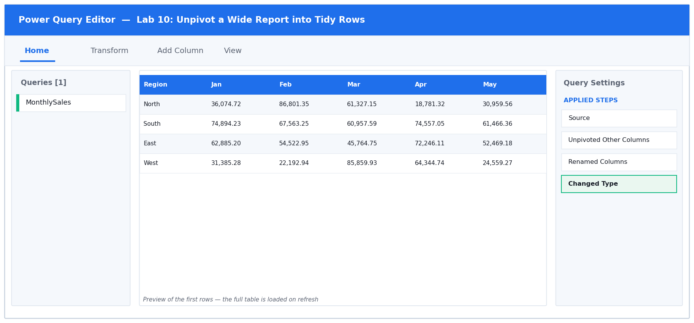

*Figure 10: the Power Query Editor for Lab 10 — queries, data preview and Applied Steps.*

**Step-by-step**

1. Open labs/lab-10-unpivot-a-wide-report-into-tidy-rows/lab-10-unpivot.xlsx. The MonthlySales sheet is a classic cross-tab: one Region column followed by twelve month columns. Readable for a person, useless for a PivotTable.

   > **You should see:** 5 data rows and 13 columns.

2. Load it with Data > From Table/Range.

3. Select ONLY the Region column by clicking its header once. Do not select the month columns.

   > **You should see:** Just the Region column is highlighted.

4. Choose Transform > Unpivot Columns > Unpivot Other Columns. This unpivots everything EXCEPT your selection — which is what makes the query survive a new month being added next year.

   > **You should see:** The table becomes 60 rows and 3 columns: Region, Attribute and Value. 5 regions x 12 months = 60.

5. Rename the new columns. Double-click Attribute and type Month; double-click Value and type Sales.

6. Set the types: Region and Month to Text, Sales to Decimal Number.

7. Understand the trap. Click the gear icon on the Unpivot step — Power Query shows which columns it is unpivoting. Had you selected the twelve month columns and chosen 'Unpivot Only Selected Columns', those twelve names would be hard-coded into the step, and a thirteenth month added to the source next year would be silently ignored. Unpivot Other Columns has no such list.

8. Load the result: Home > Close & Load To… > Table > New worksheet.

9. Prove the tidy shape works. Click inside the loaded table and choose Insert > PivotTable > From Table/Range > New Worksheet. Drag Region to Rows, Month to Columns and Sales to Values.

   > **You should see:** A working cross-tab that you can now slice by month — something the original wide layout could not do.

**Test it:** The result has exactly three columns (Region, Month, Sales) and a row count of regions x months.

**Troubleshooting**

| Symptom | Fix |
|---|---|
| The result has only 2 columns | You selected all the columns before unpivoting, so Region was unpivoted too. Select ONLY Region, then Unpivot Other Columns. |
| The row count is not 60 | Some month columns were left out of the unpivot. Check the gear icon on the step — it should be unpivoting 12 columns. |
| Sales will not sum in the PivotTable | The Sales column is still typed as text. Set it to Decimal Number in the query and refresh. |

### 5.11 Lab 11: Pivot, Pivot Without Aggregation, and Append

| | |
|---|---|
| **Maps to** | LO2 · A2 · K2, K3 — Pivot a column, use Don't Aggregate, and append queries. |
| **Starter workbook** | [`lab-11-pivot-append.xlsx`](labs/lab-11-pivot-pivot-without-aggregation-and-append/lab-11-pivot-append.xlsx) |
| **Tools** | Excel, Power Query Editor, Pivot Column, Append Queries |
| **You will produce** | A pivoted cross-tab plus an appended half-year table. |

**Scenario**

The learner reverses an unpivot to rebuild a cross-tab, meets the Don't Aggregate option that preserves individual values instead of summing them, and then appends the Q1 and Q2 extracts into a single continuous table.

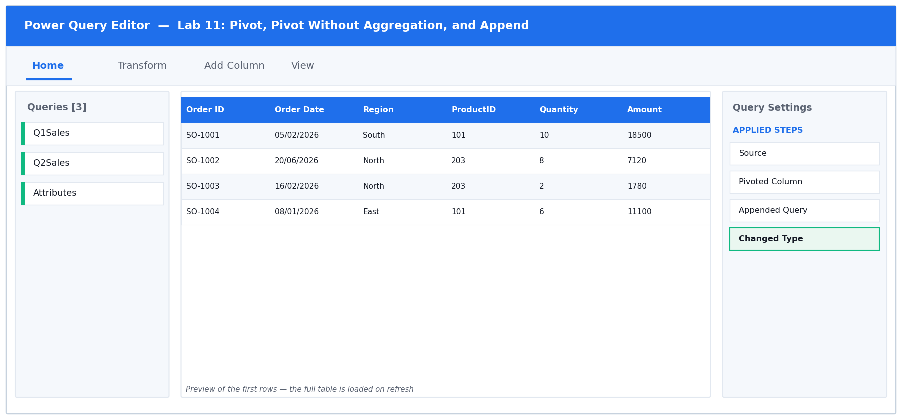

*Figure 11: the Power Query Editor for Lab 11 — queries, data preview and Applied Steps.*

**Step-by-step**

1. Open labs/lab-11-pivot-pivot-without-aggregation-and-append/lab-11-pivot-append.xlsx. It has three sheets: Q1Sales, Q2Sales and Attributes.

2. Load each of the three sheets as a SEPARATE query. Click inside Q1Sales, choose Data > From Table/Range, then immediately choose Home > Close & Load To… > Only Create Connection. Repeat for Q2Sales and for Attributes.

   > **You should see:** Queries & Connections lists three queries, each marked 'Connection only'.

3. Start with the pivot. Open the Attributes query for editing — double-click it in the Queries & Connections pane. It is in tall form: Product Name, Attribute, Value.

4. Select the Attribute column, then choose Transform > Pivot Column.

5. In the dialog set the Values Column to Value. Then expand Advanced options and set Aggregate Value Function to 'Don't Aggregate'. Click OK.

   > **You should see:** Category, Warranty and Supplier become their own columns, each holding the original TEXT. Had you left the default aggregation, Power Query would have tried to count or sum the text instead.

6. Now the append. Return to the main Excel window and choose Data > Get Data > Combine Queries > Append. Choose 'Three or more tables' only if needed — here select Two tables, with Q1Sales as the primary and Q2Sales as the table to append.

   > **You should see:** Alternatively use Home > Append Queries > Append Queries as New inside the Editor, which keeps both sources intact and creates a third query.

7. Rename the appended query to HalfYear.

   > **You should see:** The row count equals Q1 rows plus Q2 rows — 30 + 28 = 58.

8. Check for the classic append failure. Scroll right across HalfYear looking for any column that is entirely null.

   > **You should see:** There is none, because Q1Sales and Q2Sales use IDENTICAL column names. If one sheet had said 'Order Date' and the other 'OrderDate', Append would have created BOTH columns, each half full of nulls.

9. Set the types on HalfYear, then choose Home > Close & Load To… > Table > New worksheet.

**Test it:** HalfYear's row count equals Q1 rows plus Q2 rows, with no column of all nulls.

**Troubleshooting**

| Symptom | Fix |
|---|---|
| Pivot returned counts instead of the text | Advanced options > Aggregate Value Function was left on its default. Set it to Don't Aggregate. |
| Expression.Error: There were too many elements for the enumeration | Don't Aggregate found more than one value for the same key. De-duplicate the source, or choose an aggregation such as Max. |
| A column of nulls appeared after Append | The two tables' column names differ. Rename them so they match exactly, including case and spaces. |
| The appended row count is too low | You appended the wrong pair, or one query is filtered. Check each source query's own row count first. |

### 5.12 Lab 12: Summarise with Group By

| | |
|---|---|
| **Maps to** | LO2 · A2 · K1, K3 — Aggregate rows to a summary grain with Group By. |
| **Starter workbook** | [`lab-12-group-by.xlsx`](labs/lab-12-summarise-with-group-by/lab-12-group-by.xlsx) |
| **Tools** | Excel, Power Query Editor, Group By |
| **You will produce** | A regional sales summary with count, sum and average in one query. |

**Scenario**

Rather than loading 20,000 transaction rows into the grid, the learner aggregates them inside the query. The lab covers basic and advanced Group By, multiple aggregations, grouping on more than one column, and keeping the underlying rows with All Rows.

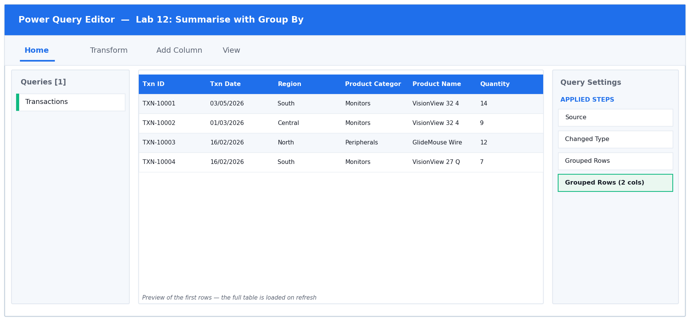

*Figure 12: the Power Query Editor for Lab 12 — queries, data preview and Applied Steps.*

**Step-by-step**

1. Open labs/lab-12-summarise-with-group-by/lab-12-group-by.xlsx. The Transactions sheet holds 400 rows — the point of this lab is to summarise them WITHOUT loading all 400 into the grid.

2. Load with Data > From Table/Range and set the types: Txn Date to Date, Quantity to Whole Number, Amount to Decimal Number.

3. Before grouping, note the grand total so you can reconcile later. Select the Amount column header and read the Sum in the status bar at the bottom of the Editor.

   > **You should see:** Write this figure down — the group totals must add back to it.

4. Choose Transform > Group By. The dialog opens in Basic mode; click ADVANCED at the top to unlock multiple aggregations.

5. Set 'Group by' to Region. Then add three aggregations using the 'Add aggregation' button: (1) New column name 'Order Count', Operation 'Count Rows'; (2) 'Total Sales', Operation 'Sum', Column 'Amount'; (3) 'Average Order', Operation 'Average', Column 'Amount'. Click OK.

   > **You should see:** 400 rows collapse to 5 — one per region — each with a count, a sum and an average. Note that Count Rows needs no source column.

6. Reconcile. Select the Total Sales column and read the Sum in the status bar.

   > **You should see:** It equals the grand total you noted in step 3. If it does not, a filter was applied somewhere before the grouping.

7. Now go finer. Click the gear icon on the Grouped Rows step, click 'Add grouping', and add Product Category as a second group-by column. Click OK.

   > **You should see:** The result expands to one row per region-and-category combination — the same aggregations at a finer grain.

8. Add a drill-through. Click the gear icon again, click Add aggregation, name it 'All Rows' and set the Operation to 'All Rows'. Click OK.

   > **You should see:** A new column of nested Table values appears. Click any cell (on the white space, not the word Table) to preview the underlying detail rows for that group at the bottom of the screen.

9. Choose Home > Close & Load To… > Table > New worksheet. Only the summary lands in the grid — the 400 detail rows stay in the query.

**Test it:** Total Sales across all groups equals the grand total of the source Amount column.

**Troubleshooting**

| Symptom | Fix |
|---|---|
| Only one aggregation is available | The dialog is in Basic mode. Click Advanced at the top. |
| Count Rows asks for a column | You selected Count (Distinct) or Count (Not blank). Choose Count Rows, which counts the group itself. |
| The group totals do not reconcile to the grand total | A filter step sits before the Group By. Check Applied Steps and reorder or remove it. |
| The All Rows column shows 'Error' | Expanding that nested column after a type change can break. Add the All Rows aggregation last. |

### 5.13 Lab 13: Build a Power Pivot Data Model with DAX Measures

| | |
|---|---|
| **Maps to** | LO2 · A2 · K3, K4 — Load to the Data Model, create relationships and write DAX measures. |
| **Starter workbook** | [`lab-13-power-pivot-model.xlsx`](labs/lab-13-build-a-power-pivot-data-model-with-dax-measures/lab-13-power-pivot-model.xlsx) |
| **Tools** | Excel, Power Query Editor, Power Pivot, DAX, Diagram View |
| **You will produce** | A Power Pivot data model with three related tables and four DAX measures. |

**Scenario**

The learner loads the fact and lookup tables to the Power Pivot Data Model, draws relationships in Diagram View, and writes explicit DAX measures. The lab contrasts an implicit measure (dragging a field into Values) with an explicit one, and explains why explicit measures are the professional practice.

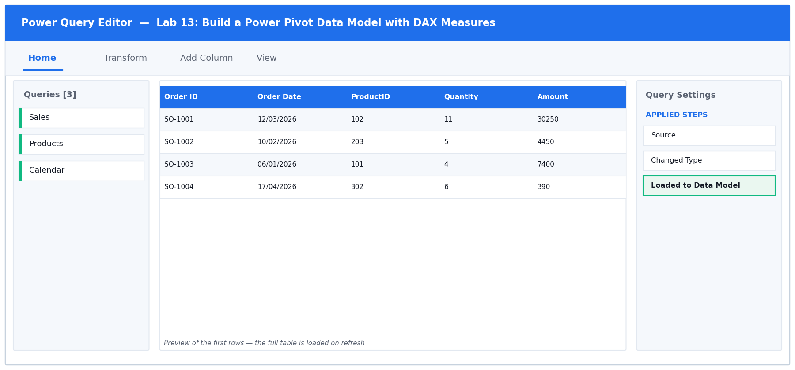

*Figure 13: the Power Query Editor for Lab 13 — queries, data preview and Applied Steps.*

**Step-by-step**

1. Enable Power Pivot if you have not already: File > Options > Add-ins > set Manage to COM Add-ins > Go > tick 'Microsoft Power Pivot for Excel' > OK.

   > **You should see:** A Power Pivot tab appears on the ribbon.

2. Open labs/lab-13-build-a-power-pivot-data-model-with-dax-measures/lab-13-power-pivot-model.xlsx. It has three sheets: Sales (300 transactions), Products (13 products) and Calendar (365 dates).

3. Load Sales to the Data Model. Click inside the Sales table, choose Data > From Table/Range, set the types in the Editor, then choose Home > Close & Load To…. Select 'Only Create Connection' AND TICK 'Add this data to the Data Model'. Click OK.

   > **You should see:** The query loads with no worksheet, but is now available to Power Pivot.

4. Repeat for Products and for Calendar — each as Only Create Connection with 'Add this data to the Data Model' ticked.

   > **You should see:** Queries & Connections lists three connection-only queries.

5. Open the model: choose Power Pivot > Manage. The Power Pivot window opens showing the three tables as tabs along the bottom.

   > **You should see:** Data View, with Sales, Products and Calendar tabs.

6. Switch to Diagram View using the button on the Home tab of the Power Pivot window (top right).

   > **You should see:** Three floating boxes, one per table, with no lines between them yet.

7. Create the first relationship: drag the ProductID field from the Sales box and drop it onto the ProductID field in the Products box.

   > **You should see:** A line appears with a 1 at the Products end and a * (many) at the Sales end — one product, many sales.

8. Create the second: drag Order Date from Sales onto Date in Calendar.

   > **You should see:** A second one-to-many line. If Power Query reports an error, the two columns are different data types — both must be Date.

9. Mark the date table, which time intelligence requires. Click the Calendar table, then on the Design tab choose Mark as Date Table > Mark as Date Table, select the Date column, and click OK.

10. Return to Data View and click the Sales tab. The Calculation Area is the grid below the data — if it is not visible, turn it on from Home > Calculation Area.

11. Click an empty cell in the Calculation Area and type this measure, then press Enter. The := operator is what makes it a measure:

   ```dax
   Total Sales := SUM(Sales[Amount])
   ```

   > **You should see:** The cell shows 'Total Sales: ' followed by the grand total of every Amount in the table.

12. In three further cells of the Calculation Area, add the remaining measures, one per cell:

   ```dax
   Order Count := COUNTROWS(Sales)
   Average Order := DIVIDE([Total Sales], [Order Count])
   Sales YTD := TOTALYTD([Total Sales], Calendar[Date])
   ```

   > **You should see:** Note that Average Order REFERENCES the other two measures by name in square brackets — this is why explicit measures are worth writing. DIVIDE is used instead of / so a zero denominator returns blank rather than an error.

13. Build a PivotTable from the model. In the Power Pivot window choose Home > PivotTable > New Worksheet, and click OK.

14. In the PivotTable Fields pane, drag Products > Category to Rows, then tick the Total Sales measure to add it to Values.

   > **You should see:** Sales totals per category. The relationship you drew is what lets a field from Products filter numbers that live in Sales.

15. Verify the total. Add Order Count and Average Order to Values as well.

   > **You should see:** The category totals add up to the grand total, and Average Order equals Total Sales divided by Order Count on every row.

**Test it:** A PivotTable with Products[Category] on rows and [Total Sales] in values returns per-category totals that sum to the grand total.

**Troubleshooting**

| Symptom | Fix |
|---|---|
| The Power Pivot tab is missing | The COM add-in is not enabled. File > Options > Add-ins > Manage: COM Add-ins > Go > tick Microsoft Power Pivot for Excel. |
| The relationship will not create | The two columns are different data types, or the lookup side is not unique. Both keys must be the same type and the lookup column must have no duplicates. |
| Sales YTD returns blank | The Calendar table was not marked as a Date Table, or it does not cover every date in the fact table. Design > Mark as Date Table. |
| The PivotTable shows the same number on every row | The relationship is missing, so the filter cannot travel. Check Diagram View for the connecting line. |
| #ERROR appears in a measure | A syntax problem — check the := operator, the bracket types (Table[Column] for columns, [Measure] for measures), and that the table name matches. |

## 6. Topic 3 — Advanced Data Analysis using Power Query

### 6.14 Lab 14: Walk Through All Six Join Kinds

| | |
|---|---|
| **Maps to** | LO3 · A3 · K2, K3 — Compare the six Power Query join kinds on the same pair of tables. |
| **Starter workbook** | [`lab-14-six-joins.xlsx`](labs/lab-14-walk-through-all-six-join-kinds/lab-14-six-joins.xlsx) |
| **Tools** | Excel, Power Query Editor, Merge Queries |
| **You will produce** | Six merge queries and a completed row-count comparison table. |

**Scenario**

Using one deliberately imperfect pair of tables — some orders reference a missing product, some products were never ordered — the learner runs all six join kinds in turn and records the row count each produces. The resulting comparison table is the reference sheet for every merge decision afterwards.

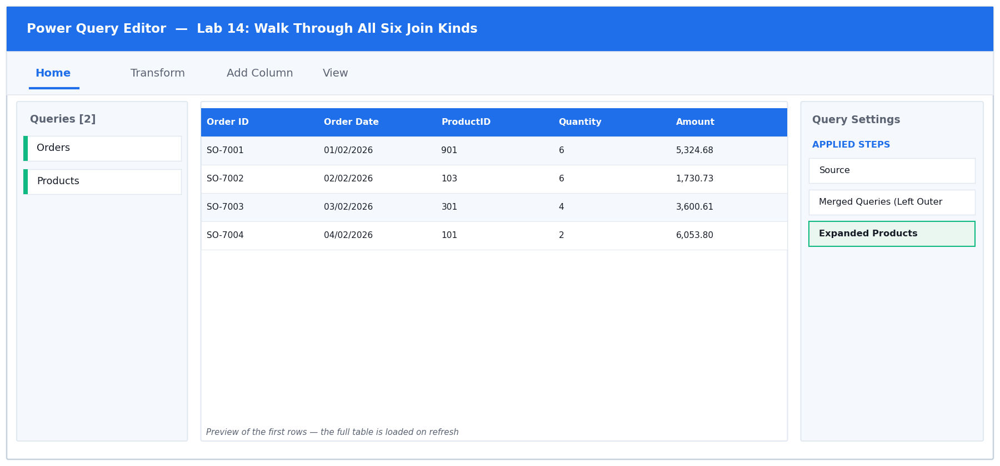

*Figure 14: the Power Query Editor for Lab 14 — queries, data preview and Applied Steps.*

**Step-by-step**

1. Open labs/lab-14-walk-through-all-six-join-kinds/lab-14-six-joins.xlsx. The data is deliberately imperfect: some Orders reference ProductIDs 901-903 that do NOT exist in Products, and ProductIDs 801-802 were never ordered. That is what makes the six joins give different answers.

2. Load Orders and Products as separate Connection Only queries, as you did in Lab 11.

   > **You should see:** Orders has 50 rows; Products has 15.

3. Note the baseline row counts — you will compare every join against them. Orders = 50, Products = 15.

4. Create the first merge. Choose Data > Get Data > Combine Queries > Merge (or Home > Merge Queries > Merge Queries as New inside the Editor). Select Orders as the top table and Products as the bottom.

5. Click the ProductID column header in EACH of the two previews to set the matching key, then set Join Kind to 'Left Outer (all from first, matching from second)'. Read the message at the foot of the dialog before clicking OK.

   > **You should see:** The dialog reports how many of the 50 rows matched. Click OK, then rename the query LeftOuter and record its row count.

6. Repeat the whole merge five more times, once per join kind, naming each query after its join: RightOuter, FullOuter, Inner, LeftAnti and RightAnti. Record the row count of each.

   > **You should see:** Left Outer = 50 (every order kept). Inner = fewer than 50 (the orphans dropped). Left Anti = only the orphan orders. Right Anti = only the products never ordered.

7. Check the arithmetic that proves you understand the joins: Inner rows + Left Anti rows should equal Left Outer rows.

   > **You should see:** Every order either matched (Inner) or did not (Left Anti) — there is no third possibility.

8. Open the LeftAnti query and look at its ProductID values.

   > **You should see:** Only 901, 902 and 903 — the orphan records. This is the fastest way in Excel to find rows referencing a code that no longer exists.

9. Open RightAnti and read its ProductID values.

   > **You should see:** 801 and 802 among others — products that have never sold. This answers the question 'which products have never been ordered?'

10. Complete the comparison table in your notes: for each of the six joins, its row count and the business question it answers. Keep it — it is your reference sheet for every merge you build afterwards.

**Test it:** Left Outer returns exactly the Orders row count; Inner returns fewer; Left Anti plus Inner equals Left Outer.

**Troubleshooting**

| Symptom | Fix |
|---|---|
| Every join returns the same row count | The matching column was not selected in BOTH previews. Click the ProductID header in each one — they highlight green when selected. |
| The merge returns MORE rows than Orders | The key is not unique on the lookup side. Products must have one row per ProductID. |
| Anti joins return nothing | You have the join direction reversed. Left Anti looks for rows of the FIRST table with no match in the second. |

### 6.15 Lab 15: Left Outer Join versus XLOOKUP

| | |
|---|---|
| **Maps to** | LO3 · A3 · K2, K3 — Reproduce an XLOOKUP with a merge and expand only the needed column. |
| **Starter workbook** | [`lab-15-merge-vs-xlookup.xlsx`](labs/lab-15-left-outer-join-versus-xlookup/lab-15-merge-vs-xlookup.xlsx) |
| **Tools** | Excel, Power Query Editor, Merge Queries, Expand |
| **You will produce** | A Sales query enriched with product details by merge instead of formulas. |

**Scenario**

The learner replaces a worksheet full of XLOOKUP formulas with a single Left Outer merge, expands only the required column, and compares the two approaches on refresh behaviour, row-count safety and performance on a large table.

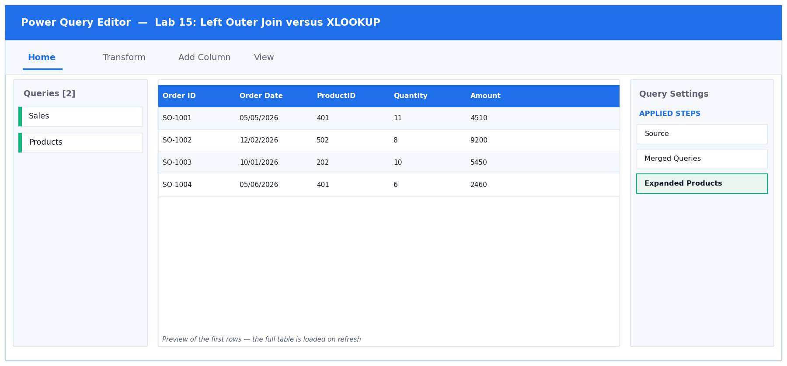

*Figure 15: the Power Query Editor for Lab 15 — queries, data preview and Applied Steps.*

**Step-by-step**

1. Open labs/lab-15-left-outer-join-versus-xlookup/lab-15-merge-vs-xlookup.xlsx. Look at cell G2 on the Sales sheet — it holds an XLOOKUP formula that pulls the product name from the Products sheet.

2. Note the weakness: that formula must be copied down whenever rows are added, it recalculates on every workbook change, and unmatched values return #N/A. You are about to replace it.

3. Load Sales with Data > From Table/Range, and load Products as a Connection Only query.

4. With the Sales query open in the Editor, choose Home > Merge Queries > Merge Queries (not 'as New' — this adds the merge into the Sales query itself).

5. Select Products as the second table, click the ProductID header in both previews, set Join Kind to Left Outer, and click OK.

   > **You should see:** A new column named Products appears at the far right, and every cell in it says the word 'Table'. Nothing useful is visible yet — this is the step everyone forgets.

6. Click the EXPAND icon (two opposing arrows) in the header of that Products column.

7. In the expand panel, untick 'Select All Columns', then tick ONLY Product Name and Category. Also UNTICK 'Use original column name as prefix' so you get clean column names. Click OK.

   > **You should see:** Two real columns appear: Product Name and Category. Expanding every column instead would bloat the query for no benefit.

8. Confirm no rows were gained or lost. Read the row count in the status bar.

   > **You should see:** Still 120 rows — exactly as many as Sales started with. A Left Outer join on a unique key never changes the row count.

9. Find how unmatched rows behave. Click the Product Name column drop-down and look for null in the value list.

   > **You should see:** Unmatched rows show null, not #N/A. You can filter or replace nulls in the query — something you cannot do as cleanly with a formula.

10. Choose Home > Close & Load To… > Table > New worksheet, then compare the two approaches: the merge refreshes with one click and never needs dragging down.

**Test it:** The merged query has the same row count as Sales, and unmatched rows show null rather than #N/A.

**Troubleshooting**

| Symptom | Fix |
|---|---|
| The new column says 'Table' on every row | You have not expanded it. Click the two-arrow expand icon in the column header. |
| Column names came out as Products.Product Name | 'Use original column name as prefix' was left ticked in the expand panel. Click the gear icon on the Expanded step and untick it. |
| The row count increased after the merge | Products contains duplicate ProductIDs. Remove duplicates on the lookup table first. |

### 6.16 Lab 16: Merge on Multiple Fields

| | |
|---|---|
| **Maps to** | LO3 · A3 · K2 — Match on a composite key using more than one column. |
| **Starter workbook** | [`lab-16-multi-field-merge.xlsx`](labs/lab-16-merge-on-multiple-fields/lab-16-multi-field-merge.xlsx) |
| **Tools** | Excel, Power Query Editor, Merge Queries |
| **You will produce** | A correctly priced sales query matched on Product plus Region. |

**Scenario**

Prices vary by both product and region, so a single-column match returns the wrong price. The learner Ctrl-clicks two columns in each table to build a composite key, and learns that column selection order determines the pairing.


*Figure 16: the Power Query Editor for Lab 16 — queries, data preview and Applied Steps.*

**Step-by-step**

1. Open labs/lab-16-merge-on-multiple-fields/lab-16-multi-field-merge.xlsx. Sales has 80 rows. RegionalPrices has 65 — because each of the 13 products has a DIFFERENT price in each of the 5 regions.

2. Load both sheets as Connection Only queries.

3. First, make the mistake deliberately so you can recognise it. Merge Sales with RegionalPrices matching on ProductID ALONE, using Left Outer. Expand the Unit Price column.

   > **You should see:** The row count explodes from 80 to 400 — every order has matched all five regional prices. Power Query gave no warning; the answer is simply wrong.

4. Delete that merge step using the X beside it in Applied Steps.

5. Now do it properly. Choose Home > Merge Queries again. In the Sales preview, click the ProductID header, then hold Ctrl and click the Region header.

   > **You should see:** Small numbers 1 and 2 appear on the two selected headers, showing the order in which you picked them.

6. In the RegionalPrices preview, click ProductID first, then Ctrl-click Region — THE SAME ORDER. The numbers must correspond: 1 pairs with 1, 2 pairs with 2.

   > **You should see:** Both previews show matching 1 and 2 badges. Reversing the order in one table would try to match a ProductID against a Region.

7. Set Join Kind to Left Outer and read the match message at the foot of the dialog BEFORE clicking OK.

   > **You should see:** It should report that all 80 of the first rows matched. If it reports far fewer, your key pairing is wrong.

8. Click OK, then expand the new column, selecting ONLY Unit Price and unticking the prefix option.

9. Confirm the row count.

   > **You should see:** Back to exactly 80 rows — one price per order.

10. Spot-check the correctness. Filter Region to North and note a product's Unit Price; then filter to Central and check the same product.

   > **You should see:** The Central price is higher than the North price for the same product, proving the region half of the key is really being used.

11. Remove the filters and choose Home > Close & Load To… > Table > New worksheet.

**Test it:** Row count matches Sales exactly, and a North-region order carries the North price, not the South one.

**Troubleshooting**

| Symptom | Fix |
|---|---|
| The row count multiplied | You matched on too few columns. Both ProductID AND Region are needed. |
| Almost nothing matched | The Ctrl-click order differs between the two tables. The badge numbers must correspond. |
| Every order shows the same price regardless of region | The merge is still on ProductID alone, or you expanded the wrong column. |

### 6.17 Lab 17: Approximate Match: Binning and Conditional Columns

| | |
|---|---|
| **Maps to** | LO3 · A3 · K2, K3 — Reproduce VLOOKUP's approximate match two ways. |
| **Starter workbook** | [`lab-17-approximate-match.xlsx`](labs/lab-17-approximate-match-binning-and-conditional-columns/lab-17-approximate-match.xlsx) |
| **Tools** | Excel, Power Query Editor, Conditional Column, Merge Queries |
| **You will produce** | A commission-rate column produced by both the conditional-column and banding-table methods. |

**Scenario**

Power Query merges are exact-match only, so VLOOKUP's TRUE behaviour must be rebuilt. The learner solves a commission-band lookup twice: once with a conditional column for fixed bands, and once with a banding table plus a merge so the bands stay data-driven.

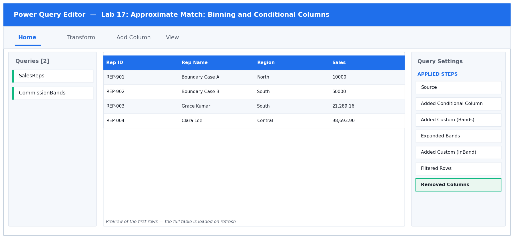

*Figure 17: the Power Query Editor for Lab 17 — queries, data preview and Applied Steps.*

**Step-by-step**

1. Open labs/lab-17-approximate-match-binning-and-conditional-columns/lab-17-approximate-match.xlsx. SalesReps holds 30 reps; CommissionBands holds three bands with Lower, Upper and Rate. REP-901 has sales of exactly 10000 and REP-902 exactly 50000 — the boundaries.

2. Understand the problem: Power Query merges are EXACT match only. VLOOKUP's approximate match (its TRUE fourth argument) has no direct equivalent, so it must be rebuilt. You will do it twice.

3. METHOD 1 — binning with a conditional column. Load SalesReps with Data > From Table/Range.

4. Choose Add Column > Conditional Column, name it Rate A, and build the rules: If Sales >= 50000 then 0.08; Else If Sales >= 10000 then 0.05; Else 0.02. Click OK, then set Rate A to Decimal Number.

   > **You should see:** REP-902 (exactly 50000) gets 0.08 and REP-901 (exactly 10000) gets 0.05, because both tests use >=. Put the LARGEST threshold first — the first matching rule wins.

5. Note the maintenance cost: if Finance changes a band next quarter, somebody must edit this query. That is the argument for method 2.

6. METHOD 2 — a data-driven banding table. Load CommissionBands as a Connection Only query so the bands live in a worksheet anyone can edit.

7. In the SalesReps query, choose Add Column > Custom Column, name it Bands, and enter just the name of the other query. This nests the entire bands table onto every row — a cross join:

   ```m
   CommissionBands
   ```

   > **You should see:** A column where every cell says 'Table'.

8. Expand that column, selecting Lower, Upper and Rate, and unticking the prefix option.

   > **You should see:** The row count multiplies from 30 to 90 — every rep paired with all three bands. That is expected; the next step filters it down.

9. Add the filter that picks the right band. Choose Add Column > Custom Column, name it InBand, and enter:

   ```m
   [Sales] >= [Lower] and [Sales] <= [Upper]
   ```

   > **You should see:** A TRUE/FALSE column. Exactly one of each rep's three rows is TRUE.

10. Filter InBand to TRUE only using the column drop-down, then remove the InBand, Lower and Upper columns (select them, right-click, Remove Columns).

   > **You should see:** Back to 30 rows — one per rep — now carrying the Rate from the banding table.

11. Compare the two methods. Both a Rate A and a Rate column now exist. Check the two boundary reps.

   > **You should see:** REP-901 and REP-902 show identical values in Rate A and Rate. If any row disagrees, one method has the boundary logic wrong.

12. Choose Home > Close & Load To… > Table > New worksheet.

**Test it:** Both methods return identical rates, including at the exact band boundaries of 10000 and 50000.

**Troubleshooting**

| Symptom | Fix |
|---|---|
| The two methods disagree at a boundary | One uses > where the other uses >=. Both must treat the boundary value the same way — check the band table's Lower/Upper values too. |
| A rep appears three times in the final table | The InBand filter was not applied, or was set to include FALSE. Filter to TRUE only. |
| A rep disappeared entirely | Their sales value falls in a gap between bands. Check that each band's Upper meets the next band's Lower with no gap. |

### 6.18 Lab 18: Cross Join and Drill Down to a Variable

| | |
|---|---|
| **Maps to** | LO3 · A3 · K1, K2 — Build a complete grid with a cross join and extract a scalar by drill down. |
| **Starter workbook** | [`lab-18-cross-join-drilldown.xlsx`](labs/lab-18-cross-join-and-drill-down-to-a-variable/lab-18-cross-join-drilldown.xlsx) |
| **Tools** | Excel, Power Query Editor, Custom Column, Drill Down |
| **You will produce** | A complete region x product grid plus a drilled-down threshold variable. |

**Scenario**

A sales matrix must show every region against every product, including combinations with no sales, so the report has no gaps. The learner builds that complete grid with a cross join, then uses Drill Down to turn a single cell into a reusable variable such as a target threshold.

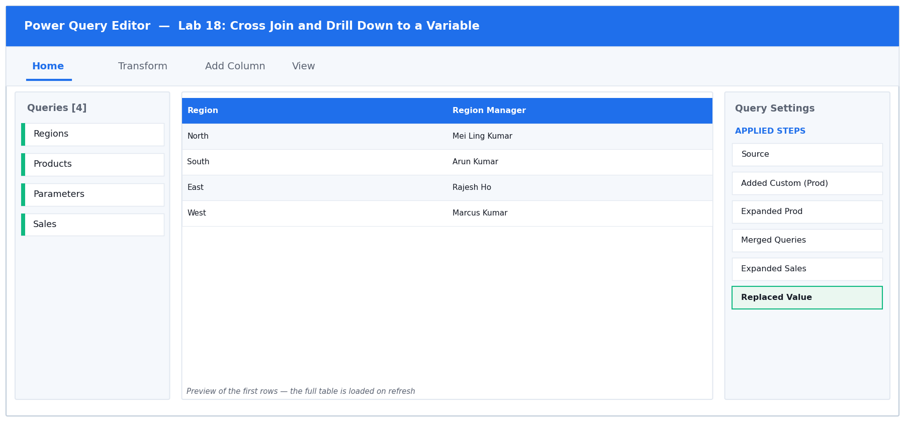

*Figure 18: the Power Query Editor for Lab 18 — queries, data preview and Applied Steps.*

**Step-by-step**

1. Open labs/lab-18-cross-join-and-drill-down-to-a-variable/lab-18-cross-join-drilldown.xlsx. It has Regions (5), Products (13), Parameters (3 settings) and Sales (45 sparse rows — not every region-product pair has sold).

2. The goal is a report with NO GAPS: every region against every product, showing 0 where nothing sold. A merge alone cannot do that, because a combination with no sales has no row to merge.

3. Load Regions, Products and Sales as Connection Only queries.

4. Open the Regions query for editing. Choose Add Column > Custom Column, name it Prod, and enter just the other query's name:

   ```m
   Products
   ```

   > **You should see:** Every row gets a nested copy of the whole Products table.

5. Click the expand icon on the Prod column and select ProductID and Product Name, unticking the prefix option.

   > **You should see:** 5 x 13 = 65 rows — every region paired with every product. That is a cross join, and it is why you must only ever do this to SMALL lookup tables: two 1,000-row tables would give a million rows.

6. Now bring in the sales. Choose Home > Merge Queries, select Sales, Ctrl-click Region then ProductID in both previews, set Join Kind to LEFT OUTER (so the grid keeps all 65 rows), and click OK. Expand the Amount column only.

   > **You should see:** 65 rows, where combinations with no sales show null in Amount.

7. Replace those nulls with zero. Right-click the Amount column header and choose Replace Values. Enter null as the Value To Find and 0 as the Replace With, then click OK.

   > **You should see:** Every one of the 65 rows now carries a number. The report has no gaps — unsold combinations read 0 rather than vanishing.

8. Now the drill down. Open the Parameters query for editing. It holds three settings as rows, and you want ONE of them as a single reusable value.

9. Find the row 'Sales Target Threshold'. Right-click the CELL in its Value column (the cell itself, not the header) and choose Drill Down.

   > **You should see:** The query no longer returns a table at all — it returns the single value 5000, shown on its own. The formula bar reads something like = Source{0}[Value].

10. Rename that query Threshold. It can now be used anywhere a value is expected — for example as a filter condition in another query, written as [Amount] >= Threshold. Changing the worksheet cell and refreshing updates every query that uses it.

   > **You should see:** This is how you parameterise a set of queries without hard-coding numbers into steps.

11. Load the grid query: Home > Close & Load To… > Table > New worksheet.

**Test it:** The grid row count equals regions x products, and unsold combinations show 0 rather than being absent.

**Troubleshooting**

| Symptom | Fix |
|---|---|
| The cross join produced far too many rows | One of the tables was not a small lookup. Only cross join small tables — the row count is the product of both. |
| Some combinations are still missing | The merge used Inner instead of Left Outer. The grid must be the FIRST table and the join must be Left Outer. |
| Drill Down returned a table, not a value | You right-clicked the column header instead of the cell. Right-click the individual cell. |
| Replace Values did not replace the nulls | Type the word null in the Value To Find box — do not leave it blank. |

### 6.19 Lab 19: Fuzzy Matching and Transformation Tables

| | |
|---|---|
| **Maps to** | LO3 · A3 · K2, K3 — Match inconsistent text with fuzzy matching and a transformation table. |
| **Starter workbook** | [`lab-19-fuzzy-matching.xlsx`](labs/lab-19-fuzzy-matching-and-transformation-tables/lab-19-fuzzy-matching.xlsx) |
| **Tools** | Excel, Power Query Editor, Fuzzy Merge, Transformation Table |
| **You will produce** | A reconciled customer query matched by fuzzy logic plus a transformation table. |

**Scenario**

Customer names arrive spelled inconsistently across two systems — 'Pte Ltd' versus 'Pte. Ltd.', typos, and abbreviations. The learner enables fuzzy matching, tunes the similarity threshold, and then supplies a transformation table to teach the engine the pairs that no similarity score will ever catch.

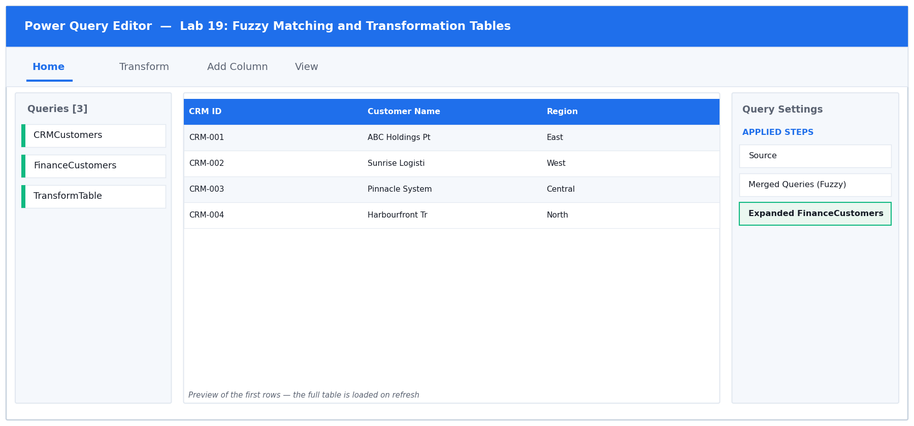

*Figure 19: the Power Query Editor for Lab 19 — queries, data preview and Applied Steps.*

**Step-by-step**

1. Open labs/lab-19-fuzzy-matching-and-transformation-tables/lab-19-fuzzy-matching.xlsx. CRMCustomers and FinanceCustomers hold the SAME 12 companies, spelled inconsistently: 'Pte Ltd' vs 'Pte. Ltd.', typos such as 'Pinacle', case differences, double spaces and abbreviations.

2. Load CRMCustomers, FinanceCustomers and TransformTable as Connection Only queries.

3. First establish the baseline. Merge CRMCustomers with FinanceCustomers on Customer Name using Left Outer, WITHOUT fuzzy matching. Expand the Outstanding column.

   > **You should see:** Most rows return null — the exact-match merge fails on almost everything, because no two spellings are identical.

4. Click the gear icon on the Merge step to reopen the dialog. Tick 'Use fuzzy matching to perform the merge'.

5. Expand 'Fuzzy matching options'. Set the Similarity threshold to 0.8, and tick both 'Ignore case' and 'Ignore space'. Click OK.

   > **You should see:** Far more rows now match. 0.8 means two values pair when they are at least 80% similar.

6. Explore the trade-off. Reopen the dialog and set the threshold to 0.6. Look carefully at which companies have paired.

   > **You should see:** More rows match, but wrong pairings appear — different companies with similar names get linked. Lower thresholds buy recall at the cost of precision, and a false match is worse than no match because it is silent.

7. Set the threshold back to 0.8. Identify which company still fails to match.

   > **You should see:** 'ABC Holdings' (CRM) versus 'ABC Group' (Finance). No similarity score will ever link these — Holdings and Group are genuinely different words. This is exactly what a transformation table is for.

8. Reopen the merge dialog once more. In Fuzzy matching options, find 'Transformation table (optional)' at the bottom and select the TransformTable query from the drop-down. Click OK.

   > **You should see:** TransformTable has two columns, From and To — those exact names are required. It maps 'ABC Group Pte. Ltd.' to 'ABC Holdings Pte Ltd' and 'Skyline Properties' to 'Skyline Property'.

9. Check the result: filter the expanded Outstanding column to look for any remaining null.

   > **You should see:** All 12 customers now reconcile, with no false matches — fuzzy matching handled the spelling variants and the transformation table handled the two it could never guess.

10. Remove the filter and choose Home > Close & Load To… > Table > New worksheet.

**Test it:** All customers reconcile at threshold 0.8 with the transformation table applied, and no false match is introduced.

**Troubleshooting**

| Symptom | Fix |
|---|---|
| Fuzzy matching is greyed out | Fuzzy matching only works on TEXT columns. Set the matching column's type to Text first. |
| Wrong companies matched together | The threshold is too low. Raise it towards 0.85-0.90 and use a transformation table for the genuine exceptions. |
| The transformation table has no effect | Its columns must be named exactly From and To, and it must be loaded as a query before it appears in the drop-down. |
| Some rows match more than once | Fuzzy matching found several candidates above the threshold. Raise the threshold, or tick 'Show match similarity' to inspect the scores. |

## 7. Quick Reference

### 7.1 The Six Join Kinds

| Join kind | Which rows you keep | Typical use |
|---|---|---|
| **Left Outer** | All left rows + matches from the right | The safe default; XLOOKUP replacement |
| **Right Outer** | All right rows + matches from the left | Rare — usually swap the tables |
| **Full Outer** | Every row from both tables | Reconciling two systems |
| **Inner** | Only rows matching on both sides | Confirmed, complete records only |
| **Left Anti** | Left rows with NO match on the right | Find orphans |
| **Right Anti** | Right rows with NO match on the left | Find unused lookups |

### 7.2 The DAX Measures from Lab 13

```dax
Total Sales := SUM(Sales[Amount])
Order Count := COUNTROWS(Sales)
Average Order := DIVIDE([Total Sales], [Order Count])
Sales YTD := TOTALYTD([Total Sales], Calendar[Date])
```

## 8. Assessment

- Written Assessment (WA) — Short-Answer Questions (SAQ), 1 hour, open book.
- Practical Performance (PP) — hands-on Power Query and Power Pivot tasks, 1 hour, open book.
- A minimum of 75% attendance is required to be eligible for assessment and funding.

---

*© 2026 Tertiary Infotech Academy Pte Ltd. All rights reserved. · www.tertiarycourses.com.sg*